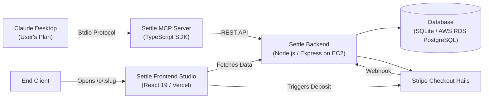

# Settle — Conversational Billing for Creative Freelancers

> **Volopay Product & Tech Assignment Submission**  
> *"Build a business that runs on Claude, with no AI inside it."*  
> Reviewers: `sandeep.juttuga@volopay.co`, `rosh@volopay.co`  
> Target Freelancer Beachhead: **Commercial & Social Video Editors**

---

## 🎯 1. Executive Summary & The Problem

Creative freelancers—especially commercial video editors—spend **up to 30% of their billable week trapped in administrative friction**:
1. **The Blank Page Proposal Trap:** Drafting custom proposals from scratch or wrestling with bloated form-heavy CRMs (HoneyBook, Dubsado).
2. **The Revision Scope Creep:** Clients routinely request "just one more color pass or audio tweak" because standard invoices lack explicit revision boundaries.
3. **The Upfront Cashflow Gap:** Freelancers start work before securing a deposit, leading to delayed payments and awkward follow-ups.

**Settle eliminates this entire administrative overhead by turning Claude into the freelancer's Autonomous Billing Operations Desk.**

The freelancer chats naturally with Claude Desktop on their own Claude plan. Claude parses client briefs, calculates milestone splits, drafts unambiguous scope boundaries, and commits live proposals to Settle via the **Model Context Protocol (MCP)**. The client receives a clean public link, reviews terms, and pays a 50% deposit in 1 click via Stripe.

**Crucially: Settle contains ZERO AI.** No OpenAI keys, no Anthropic API keys, and zero token inference costs.

---

## 🏆 2. Volopay Assignment Compliance Matrix

| Volopay Requirement | Settle Implementation | Verified Evidence |
| :--- | :--- | :--- |
| **"Type in Claude, something real appears in the app"** | Freelancer types: *"Draft a proposal for Acme: 3-week commercial video edit, $4,800, 50% deposit"* $\rightarrow$ Claude executes `create_proposal` via MCP $\rightarrow$ A live, interactive proposal appears instantly at `/p/acme-brand-refresh-2026`. | Public URL generated directly in Claude's turn with itemized deliverables, revision limits, and turnaround specs. |
| **"Human edits it in the app"** | Freelancer opens the Settle Dashboard, clicks **"Edit"** on any proposal to adjust deliverables, revise timeline days, adjust total price, or refine clauses before client settlement. | In-place override modal updates the database in real-time. |
| **"Zero AI inside the web app"** | Settle is a deterministic **Node.js / Express + TypeScript + SQLite / PostgreSQL** engine. It does not import `@anthropic-ai/sdk`, `openai`, or run any neural networks. Claude acts purely as the external client calling MCP tools over stdio/HTTP. | 100% deterministic backend with zero inference margins. |
| **"Not a website builder or store"** | Settle is a dedicated **freelance proposal & milestone settlement operating system** solving deal-closing and payment rails. | Focused strictly on commercial video editors and creative contractors. |
| **"Viable business model"** | Because Settle has **$0 in AI inference costs**, it can offer a free tier (up to 2 open proposals) and charge **$9/month for Pro** (unlimited proposals, custom domain, auto-reminders)—severely undercutting HoneyBook ($29–$109/mo) and Bonsai ($19–$49/mo). | High 90%+ gross margins on SaaS subscription + optional 1% transaction fee on processed payments. |

---

## ⚔️ 3. Competitive Landscape Comparison

| Competitor | Target User | Pricing (2025/2026) | Feature Footprint | Settle's Winning Advantage |
| :--- | :--- | :--- | :--- | :--- |
| **HoneyBook** | Event pros, creative agencies | **$29–$109/mo** (billed annually) or up to $129/mo | Heavy all-in-one CRM: scheduling, drip emails, contracts, portal. | **Zero configuration overhead**: HoneyBook takes days of template setup. Settle requires zero setup—Claude writes everything from a 1-line chat brief. |
| **Bonsai** *(Zoom)* | General freelancers, consultants | **$19–$49/mo** (Basic at $9/mo omits invoicing/contracts) | Proposals, e-sign contracts, timesheets, accounting add-on. | **Focus & price**: Freelancers don't need timesheets or tax estimators to close a \$3,000 gig. Settle charges \$0–\$9/mo with zero cognitive clutter. |
| **Dubsado** | Boutique service providers | **$20–$40/mo** | Complex multi-stage workflows, conditional questionnaires, client portal. | **Anti-bloat**: Dubsado has a notoriously steep learning curve and dated UI. Settle is pure conversational speed. |
| **FreshBooks** | Traditional small business, accountants | **$19–$60+/mo** + per-client fees | Double-entry accounting, mileage tracking, bookkeeping. | **Conversion moment**: FreshBooks is built for tax time, not the moment of closing a deal. Settle optimizes for proposal-to-deposit velocity. |
| **Wave** | Bootstrapping solo businesses | **Freemium** (Starter free, **Wave Pro at $19/mo**) | Invoicing, basic bookkeeping. Auto-reminders locked behind paywall. | **Proposal depth**: Wave lacks milestone approvals and scopes. Settle enforces revision limits and 50% upfront deposits automatically. |
| **AND.CO** *(Fiverr)* | Creative freelancers | **Defunct (Discontinued March 1, 2026)** | Platform permanently shut down by Fiverr. | **Capturing orphan users**: Displaced freelancers refuse heavy CRM tools. Settle is their modern conversational home. |
| **Stripe Invoicing** | Developers, contractors | **Pay-as-you-go** (2.9% + fees) | Naked payment links and PDF receipts. | **Contextual value**: Stripe links provide no scope protection. Settle wraps Stripe checkout in a legally protective milestone proposal. |

---

## 🛠️ 4. Technical Architecture

### Exposed MCP Tools:
1. `add_client(name, email, currency)`: Registers a client profile.
2. `create_proposal(client_id, title, body, line_items, deposit_percentage, revisions_included, turnaround_days)`: Builds interactive proposal and returns public link.
3. `create_invoice(client_id, amount, due_date, items)`: Issues itemized invoice with direct Stripe payment link.
4. `get_status()`: Summarizes active pipeline, open proposals, and paid deposits.
5. `send_reminder(invoice_id)`: Triggers payment reminder for pending invoices.

---

## 🎬 5. The 60-Second Reviewer Pitch Demo

1. **Step 1:** In Claude Desktop, type:
   > *"Draft a commercial video editing proposal for Acme Studio: 3-week brand refresh, $4,800, 50% deposit, 14 days turnaround, 2 revisions included. Call create_proposal."*
2. **Step 2:** Claude returns the live public link: `http://localhost:5173/p/acme-brand-refresh-2026`.
3. **Step 3:** Open the link. Review the clean, anti-slop proposal specs with itemized deliverables.
4. **Step 4:** Click **"Accept & Pay Deposit ($2,400.00)"**. Stripe Checkout opens in test mode.
5. **Step 5:** Complete test payment $\rightarrow$ The proposal instantly updates to **"Milestone Deposit Paid & Schedule Confirmed"**.
6. **Step 6:** Check Settle Dashboard $\rightarrow$ Pipeline telemetry flips to **Deposits Cleared: $2,400**.
